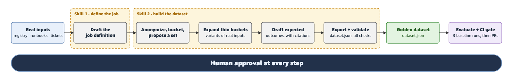

# Golden dataset skills for agent evaluation

This repository contains two [Agent Skills](https://agentskills.io/specification) that build a golden dataset for an agent from real inputs. The first skill interviews a product owner and drafts a job definition. The second turns that definition and your real sources (sessions, tickets, runbooks) into routine, hard and boundary scenarios with expected outcomes, and exports a `dataset.json` that Amazon Bedrock AgentCore's dataset runners can load. A person approves every step, and gaps are reported instead of invented.

## What's in this repository

| Path | Purpose |
|---|---|
| `skills/golden-dataset-1-define-job/` | Skill 1. Interviews the product owner and writes `job-definition.yaml` and a one-page `job-definition.md` |
| `skills/golden-dataset-2-build-dataset/` | Skill 2. Builds the dataset from the job definition and real inputs, then runs 13 validation checks |
| `examples/incident-analysis/sources/` | Sample sources for an incident-analysis agent (a service registry, its planned tools, a change log, runbooks, postmortems and triage-channel requests), the blog post's running example |
| `GLOSSARY.md` | The IDs, fields and evaluators the skills, the sample and the blog post use, and how they connect |
| `docs/flow.png` | Flow diagram |

The sample data is made up. It includes one planted customer name so you can see the anonymization step work.

## Prerequisites

- A coding agent that loads Agent Skills, such as Kiro or Claude Code.
- No AWS account is needed to build the dataset, only to run it against your agent.
- Optional: Python 3 and [uv](https://docs.astral.sh/uv/). One of Skill 2's checks, Loads, confirms that AgentCore can read the exported `dataset.json` by loading it with the `bedrock-agentcore` Python package. The skill installs that package in a temporary environment with `uv run --with bedrock-agentcore`, so your own setup is unchanged. If you won't run the dataset on AgentCore, you can skip this check and record that in the validation report.

## Quick start

1. Clone this repository.
2. Copy both folders under `skills/` into the skills folder your agent reads.

   | Agent | Project skills | Personal skills |
   |---|---|---|
   | Kiro | `.kiro/skills/` | `~/.kiro/skills/` |
   | Claude Code | `.claude/skills/` | `~/.claude/skills/` |

3. Start Skill 1 and paste in your own sources when it asks. To try the skills first, use the files in `examples/incident-analysis/sources/`.
4. Answer its interview questions, sign the job definition, and run Skill 2 on it.

You end with a `dataset.json` and a validation report listing any gaps that need a real input.

## Use the dataset

To score your agent, run the `dataset.json` the skills produce through the [AgentCore batch dataset runner](https://docs.aws.amazon.com/bedrock-agentcore/latest/devguide/dataset-evaluations-batch.html). It sends every scenario to your agent and compares each reply with the expected outcomes in the file. That comparison is a [ground truth evaluation](https://docs.aws.amazon.com/bedrock-agentcore/latest/devguide/ground-truth-evaluations.html), and its page explains the expected-outcome fields (`expected_response`, `assertions` and `expected_trajectory`). Run it with the evaluators your scenarios list in `metadata.evaluator`. The [glossary](GLOSSARY.md) shows which evaluator grades which field.

The [AgentCore on-demand dataset runner](https://docs.aws.amazon.com/bedrock-agentcore/latest/devguide/dataset-evaluations-on-demand.html) reads the same file and returns results scenario by scenario, which suits development and CI/CD. [Automated agent evaluation with Amazon Bedrock AgentCore and GitHub Actions](https://aws.amazon.com/blogs/machine-learning/automated-agent-evaluation-with-amazon-bedrock-agentcore-and-github-actions/) runs on-demand evaluation from its own script as a check on every pull request.

Either way, run it a few times before you change the agent to get a baseline. After each change, run it again and compare against that baseline. AgentCore dataset evaluation is in public preview, so check its docs for changes.

## Learn more

- Blog post: coming soon

## License

The skills and sample data in this repository are licensed under MIT-0; see [LICENSE](LICENSE).
